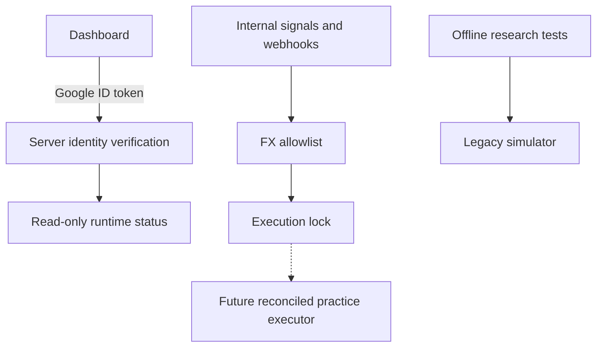

# Trading Pod

An FX research experiment being rebuilt around OANDA v20 practice accounts. The first development milestone establishes a locked execution boundary and server-verified dashboard access.

**Current status: execution paused; broker not connected.** This build cannot start practice trading or live trading. It retains the original deterministic agents and offline simulation code for evaluation; their results are not evidence of a trading edge.

## Implemented in the foundation

- Explicit deployment modes: `RESEARCH`, `SHADOW`, `OANDA_PRACTICE`, `LIVE_LOCKED`. All remain paused in this milestone. Unknown values, including the old `paper` and `live` values, fail closed.
- FX ingress allowlist: EUR/USD, GBP/USD, USD/JPY, normalised to OANDA instrument names.
- No live OANDA endpoint or custom broker endpoint setting. Legacy broker selection cannot route to a real adapter.
- Google ID tokens verified on the server using Google's signing keys, issuer, audience, expiry and a server-side subject allowlist. No shared credentials in browser builds.
- Read-only dashboard status, disabled trading controls, and rejected placeholder capital allocations.
- Weekly review contract: **Saturday, 09:00 Europe/London**, after the trading week. This defines the intended report schedule; an in-service report generator is still to be built.

## Architecture now



The broker connection, risk ledger, trade lifecycle and forward research pipeline are next. See [development status](docs/development_status.md) for acceptance gates and the distinction between working code and retained prototypes.

## Run and verify

Node 20+ and the pinned pnpm 9.15.4 are required.

```bash
corepack pnpm install --frozen-lockfile
corepack pnpm -r build
corepack pnpm -r typecheck
corepack pnpm test
```

Build first: TypeScript project references need the dependency declarations before the recursive type check. On environments with a different global pnpm version, use the explicit `corepack pnpm -r` commands above.

The test suite covers existing research modules plus signed-token verification, unsafe modes, non-FX ingress, locked controls, capital refusal and the retirement of shared-token WebSockets. See CI for the current test count.

For local UI development:

```bash
corepack pnpm --filter @trading-pod/dashboard dev
```

Without sign-in configuration the login page stays locked. To configure server-verified access, follow the [install checklist](docs/install_checklist.md). There is no unauthenticated development bypass.

## Stack and reuse

| Component                                    | Current role                                             |
| -------------------------------------------- | -------------------------------------------------------- |
| TypeScript / pnpm monorepo                   | Shared contracts and deterministic research modules      |
| React / Vite / Tailwind / Recharts / Zustand | Dashboard shell and authenticated status                 |
| Cloudflare Workers                           | Existing HTTP boundaries, now locked                     |
| D1 / KV                                      | Legacy storage; KV does not control execution readiness  |
| jose / Google Identity Services              | Server token verification / sign-in UI                   |
| Vitest / GitHub Actions                      | Regression and safety checks                             |
| OANDA v20                                    | Selected practice broker; connection not implemented yet |

Existing IG and Capital.com stubs, tax/savings modules and credibility formulas remain historical prototypes. They are not supported execution paths or validated financial guidance. The new runtime admits FX only.

No hosting, paid data, broker account, or LLM service is provisioned by these changes. Deployment and recurring infrastructure costs remain to be chosen.

## Documentation

- [Development status and next milestones](docs/development_status.md)
- [Architecture](docs/architecture.md)
- [Safety model](docs/safety_model.md)
- [Security and authentication](docs/security.md)
- [Broker setup](docs/broker_setup.md)
- [Local setup](docs/install_checklist.md)
- [Dashboard](docs/dashboard_design.md)
- [Deployment notes](docs/cloudflare_deployment.md)
- [TradingView ingress](docs/tradingview_setup.md)

The project makes no claim of profitability. Live execution is outside this build and requires a separate design, evidence review and authorisation.
